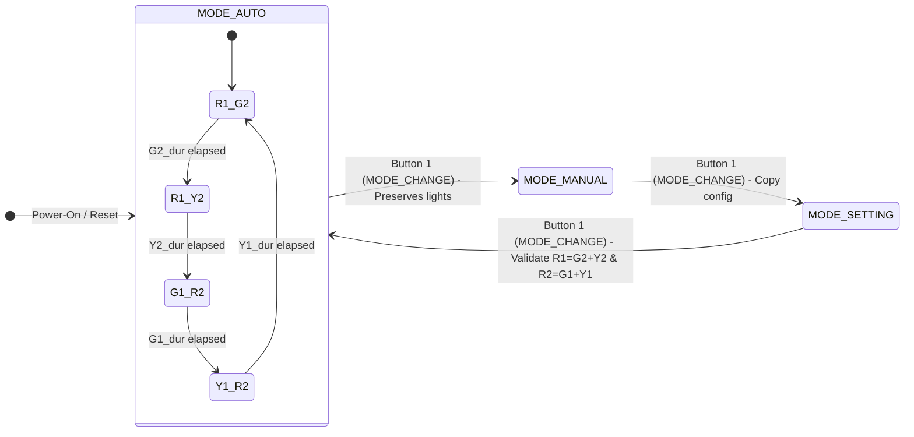

<div align="center">

# 🚦 Two-Road Traffic Light System on STM32

**Course Project - Microprocessors & Microcontrollers (CO3009)**  
*Ho Chi Minh City University of Technology (HCMUT) • Class CC02 • Group Triple Tu*

<p>
  
  
  
  
  
</p>

<p>
  <a href="#-key-features">Features</a> •
  <a href="#-system-architecture">Architecture</a> •
  <a href="#-hardware-connections">Hardware</a> •
  <a href="#-operating-modes--controls">Controls</a> •
  <a href="#-scheduler-task-table">Scheduler</a> •
  <a href="#-build-flash--simulation">Build & Flash</a> •
  <a href="#-contributors">Contributors</a>
</p>

</div>

---

An embedded two-road intersection traffic light controller built on the **XNUCLEO-F103RB** (`STM32F103RBT6`, ARM Cortex-M3) featuring a deterministic **$O(1)$ cooperative scheduler**, **hardware-independent Finite State Machines (FSMs)**, real-time **DHT20** temperature/humidity monitoring on a **16×2 I2C LCD**, and **automatic I2C bus & hot-plug fault recovery**.

---

## ✨ Key Features

| Pillar | Highlights |
| :--- | :--- |
| ⚡ **$O(1)$ Cooperative Scheduler** | Delta-delay sorted static task queue (`SCH_MAX_TASKS = 10`) driven by a 10 ms `TIM2` interrupt, supporting periodic & one-shot tasks, `PRIMASK` critical-section guards, and `__WFI()` low-power sleep. |
| 🧠 **Hardware-Independent FSMs** | Three decoupled modes (`fsm_auto`, `fsm_manual`, `fsm_setting`) with a uniform `_init / _enter / _run / _exit` API, pointer-injected context (`global.h`), and zero HAL/GPIO/I2C calls inside FSM logic. |
| 🚦 **3 Operating Modes** | 🟢 **Automatic**: 4-phase cycle (`R1-G2 → R1-Y2 → G1-R2 → Y1-R2`) with live countdowns.<br>🟡 **Manual**: Preserves active lights on entry & enforces timed Amber safety buffers (`Y1_dur` / `Y2_dur`).<br>🔧 **Setting**: Independent 6-field tuning (`R1..G2`, 1–99 s), 2 Hz single-road blink, `"SET!"` (2 s), and cross-road validation (`R1 == G2 + Y2 && R2 == G1 + Y1`) with `"INVALID! R!=G+Y"` (2 s). |
| 🌡️ **Non-Blocking DHT20 & LCD** | Polls **DHT20** (`0x38`) every 2 s via trigger + 100 ms one-shot read task with CRC-8 & fixed-point math (`0.1 °C`, `0.1 %RH`). Drives **16×2 LCD** (`0x21`) via differential shadow buffers (`lcd_want` vs. `lcd_shown`), flushing ≤ 1 row per 50 ms tick. |
| 🛡️ **Safety & I2C Resilience** | Coordinator dual-Green interlock, **I2C1 9-clock + RCC bus recovery** (`i2c.c`), **non-blocking 4-state LCD hot-plug re-init** (`lcd.c`), and automatic per-transaction **Soft-I2C fallback** for Proteus simulation. |

---

## 🏗️ System Architecture

### Mode-Switching State Machine



> [!IMPORTANT]
> **Cross-Road Synchronization Rule:** When exiting **Timing Adjustment Mode**, both constraints `R1 == G2 + Y2` and `R2 == G1 + Y1` must hold simultaneously. Otherwise, `temp_config` is discarded, `"INVALID! R!=G+Y"` is displayed for 2 s, and the last valid configuration remains active.

---

## 🔌 Hardware Connections

### Pinout Mapping (`XNUCLEO-F103RB`)

| Peripheral | Arduino Pin | STM32 Pin | GPIO Mode | User Label |
| :--- | :---: | :---: | :--- | :--- |
| 🚦 **Traffic Light 1** | `D3`, `D4` | `PB3`, `PB5` | Output Push-Pull (No Pull) | `LED1_1` (Sig A), `LED1_2` (Sig B) |
| 🚦 **Traffic Light 2** | `D5`, `D6` | `PB4`, `PB10` | Output Push-Pull (No Pull) | `LED2_1` (Sig A), `LED2_2` (Sig B) |
| 🔘 **Buttons 1, 2** | `D7`, `D8` | `PA8`, `PA9` | Input (No Pull, ext. pull-up) | `Button1_1`, `Button1_2` |
| 🔘 **Buttons 3, 4** | `D9`, `D10` | `PC7`, `PB6` | Input (No Pull, ext. pull-up) | `Button2_1`, `Button2_2` |
| 💡 **On-board LEDs** | `-` | `PA5`, `PC9` | Output Push-Pull (No Pull) | `Flashing`, `Built_IN_LED` |
| 🔵 **USER Button** | `-` | `PC13` | EXTI Rising (Polled Active-Low) | `B1` |
| 🌡️ **DHT20 & LCD** | I2C Header | `PB8` (SCL), `PB9` (SDA) | AF Open-Drain (`I2C1` Remap, 100 kHz) | DHT20: `0x38` • LCD: `0x21` |

### 2-Bit Traffic Light Signal Encoding

| Signal 1 (MSB) | Signal 2 (LSB) | Enum (`Traffic_Light_State`) | Light Output |
| :---: | :---: | :--- | :--- |
| `0` | `0` | `TL_OFF` | ⚫ All LEDs Off |
| `0` | `1` | `TL_AMBER` | 🟡 Amber LED On |
| `1` | `0` | `TL_GREEN` | 🟢 Green LED On |
| `1` | `1` | `TL_RED` | 🔴 Red LED On |

---

## 🎮 Operating Modes & Controls

Default timing configuration after reset: **🔴 Red = `5 s`** • **🟢 Green = `3 s`** • **🟡 Amber = `2 s`**

| Button | 🟢 Automatic Mode | 🟡 Manual Mode | 🔧 Timing Adjustment Mode |
| :--- | :--- | :--- | :--- |
| **Button 1** (`D7 / PA8`) | Switch to Manual (`MODE_CHANGE`) | Switch to Setting (`MODE_CHANGE`) | Validate `R1==G2+Y2 && R2==G1+Y1` & return to Auto |
| **Button 2** (`D8 / PA9`) | - | Short press: Switch road via Amber buffer (`SWITCH_LIGHT`) | Short press: Cycle `R1 → Y1 → G1 → R2 → Y2 → G2` |
| **Button 3** (`D9 / PC7`) | - | - | Short press / 1 s hold: `+1 s` (wrap `99 → 1`) & clear `SET!` |
| **Button 4** (`D10 / PB6`) | - | - | Short press / 1 s hold: `-1 s` (wrap `1 → 99`) & clear `SET!` |
| **USER B1** (`PC13`) | - | - | Short press: Save field into `temp_config` & show `"SET!"` (2 s) |

---

## ⏱️ Scheduler Task Table

`SYSCLK = 8 MHz (HSI/2 × PLL2)` • `TIM2: PSC = 7999, ARR = 9` → **`10 ms` (100 Hz) System Tick**

| Task | Initial Delay | Period | Responsibility |
| :--- | :---: | :---: | :--- |
| `button_reading` | `0 ms` (0 ticks) | `10 ms` (1 tick) | Polls 5 buttons (2-sample debounce, falling-edge & 1 s long-press) |
| `system_fsm_task` | `0 ms` (0 ticks) | `10 ms` (1 tick) | 250 ms / 1 s dividers, event mapping, coordinator, active FSM, safety interlock |
| `display_task` | `50 ms` (5 ticks) | `100 ms` (10 ticks) | Formats LCD line 0 (mode / countdown / `SET!` / `INVALID!`) & line 1 (DHT20) |
| `lcd_flush_task` | `60 ms` (6 ticks) | `50 ms` (5 ticks) | Flushes ≤ 1 changed LCD row over I2C & runs non-blocking hot-plug recovery |
| `env_sample_task` | `100 ms` (10 ticks) | `2000 ms` (200 ticks) | Triggers DHT20 measurement (`0xAC 0x33 0x00`) & schedules `env_read_task` |
| `env_read_task` | `100 ms` (10 ticks) | **One-shot** (`0`) | Reads 7 bytes after ≥ 80 ms conversion, checks busy flag & CRC-8 |

---

## 📂 Project Structure

<details>
<summary><b>Click to expand repository tree</b></summary>

```text
traffic_light_mcmp-assignment/
├── Core/
│   ├── Inc/
│   │   ├── button.h, dht20.h, env_display.h, global.h
│   │   ├── fsm_auto.h, fsm_manual.h, fsm_setting.h
│   │   ├── gpio.h, i2c.h, lcd.h, main.h, scheduler.h, tim.h, traffic_light.h
│   │   └── stm32f1xx_hal_conf.h, stm32f1xx_it.h
│   ├── Src/
│   │   ├── button.c, dht20.c, env_display.c, global.c
│   │   ├── fsm_auto.c, fsm_manual.c, fsm_setting.c
│   │   ├── gpio.c, i2c.c, lcd.c, main.c, scheduler.c, tim.c, traffic_light.c
│   │   └── stm32f1xx_hal_msp.c, stm32f1xx_it.c
│   └── Startup/
│       └── startup_stm32f103rbtx.s
├── Drafts/
│   ├── fsm_documentation.md
│   ├── teammate_fixes_note.md
│   └── traffic_fsm.drawio
├── Drivers/
│   ├── CMSIS/
│   └── STM32F1xx_HAL_Driver/
├── Demo.pdsprj          # Proteus ISIS simulation schematic
├── traffic_light.ioc    # STM32CubeMX hardware configuration
└── README.md
```

</details>

---

## 🚀 Build, Flash & Simulation

### 1. Hardware Build & Flash (`XNUCLEO-F103RB`)

```bash
git clone https://github.com/trananhtuhcmut/traffic_light_mcmp-assignment.git
```

1. Open **STM32CubeIDE** → **File → Open Projects from File System...** → select the cloned directory.
2. Verify CubeMX settings: Board **`NUCLEO-F103RB`**, **SYS → Debug: `Serial Wire`** (frees `PB3`/`PB4` from JTAG).
3. Build (**`Ctrl + B`**) and flash via ST-LINK (**Run**).

### 2. Proteus Simulation (`Demo.pdsprj`)

> [!TIP]
> Proteus simulates **`STM32F103R6` (32 KB Flash)**. Before generating `.hex`, check **Convert to Intel Hex file (`-O ihex`)** under **MCU Post build outputs**.

1. Build the project and load `Debug/traffic_light.hex` into `U1` in `Demo.pdsprj` (`Crystal Frequency = 8MHz`).
2. Since Proteus has no native I2C DHT20 model, LCD line 1 safely displays `T:--.-C H:--.-%` while the LCD runs automatically via the built-in Soft-I2C fallback.

---

## 👥 Contributors

**Instructor:** Dr. Nguyễn Hòa Hưng - *Faculty of Computer Science and Engineering, HCMUT*

| Student | Student ID | Main Responsibilities |
| :--- | :---: | :--- |
| **Trần Anh Tú** | `2453387` | GitHub & STM32CubeIDE setup; hardware verification; O(1) cooperative scheduler; traffic light, debounced button & timing drivers |
| **Nguyễn Lê Khải Tú** | `2453384` | FSM architecture design; Automatic Mode FSM (`fsm_auto`); Manual Mode FSM (`fsm_manual`) with Amber safety buffer |
| **Huỳnh Lương Anh Tú** | `2453380` | I2C1 setup & bus recovery; DHT20, LCD & display drivers (`dht20`, `lcd`, `env_display`); Timing Adjustment FSM (`fsm_setting`) with cross-road validation; project report |

---

<div align="center">
  <sub>Built with (gay) ❤️ by Group <b>Triple Tu</b> • CO3009 Microprocessors – Microcontrollers • HCMUT</sub>
</div>
